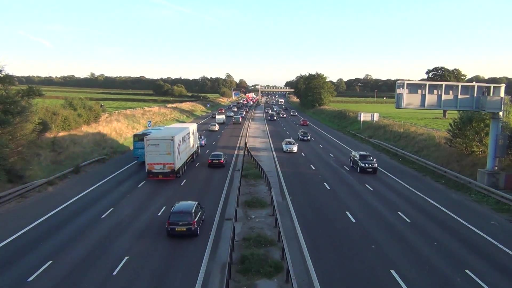

# Vehicle Speed Detection dari CCTV

Estimasi kecepatan kendaraan (km/h) dari video CCTV memakai YOLOv8 + tracking ByteTrack + 2 garis virtual.



## Isi repo

- `local_speed.py` — script utama (run lokal, CPU)
- `vehicle_speed_detection_colab.ipynb` — versi notebook (Colab, GPU)
- `test_30s.mp4` — contoh video input
- `data/f60.jpg` — contoh frame; `data/thumb.png` — thumbnail

## Cara pakai

```bash
python -m venv .venv && source .venv/bin/activate
pip install -r requirements.txt
# butuh ffmpeg agar output bisa diputar di QuickTime/VS Code:
# macOS: brew install ffmpeg | Ubuntu: sudo apt install ffmpeg

python local_speed.py --video test_30s.mp4 --seconds 30
```

Hasil: `out_local.mp4` (video anotasi) + `speeds_local.csv` (kecepatan per kendaraan).

Model `yolov8n.pt` tidak ikut di-push — otomatis diunduh `ultralytics` saat pertama run.

## Kalibrasi wajib

`real_distance_m = 10.0` di `CONFIG` masih placeholder. Ukur jarak marka jalan di lokasi CCTV lalu ganti nilainya, kalau tidak semua angka kecepatan salah skala.
